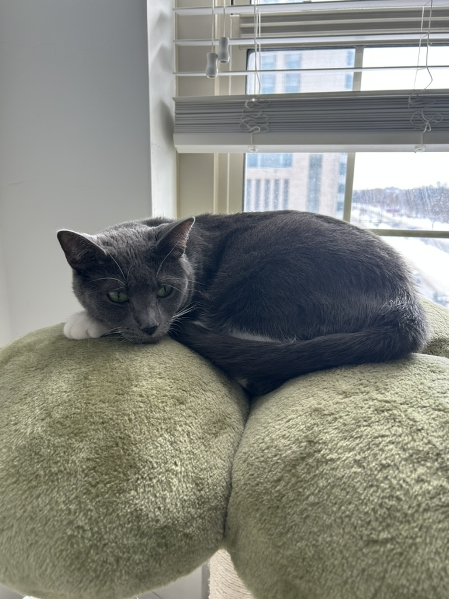
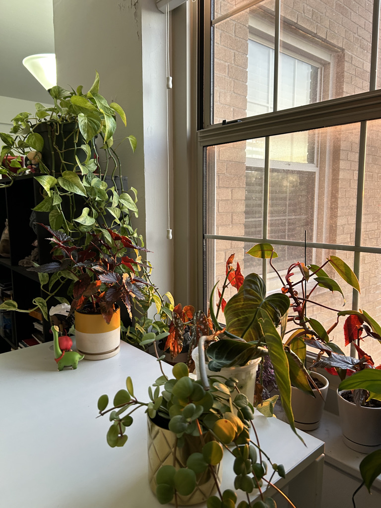

# Welcome!

This is where you can find information about me and my work as a public health student at Columbia Mailman School of Public Health.

### A bit about me:

I am from the Bay Area, California. I care a lot about mental health and have worked in the mental health field for most of my career. My favorite parts of my life are my cat, plants, and loved ones.

My cat, Soots:

Some of my plants:

